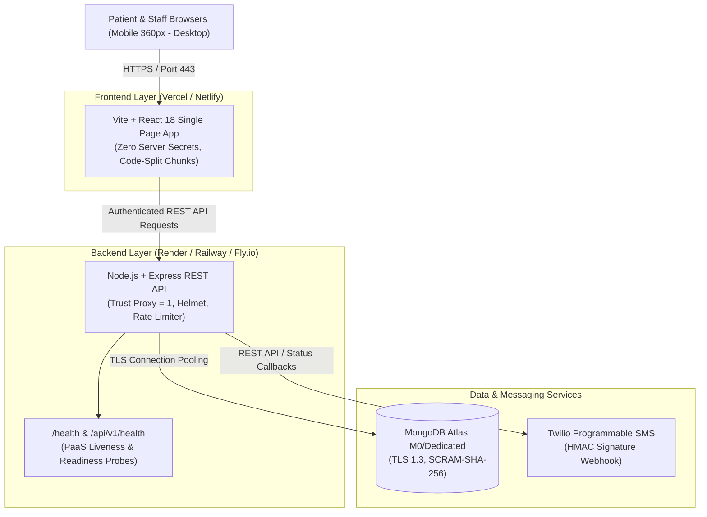

# Production Deployment & Environment Setup Guide

**Project:** Smart Queue & Token System for Local Clinics  
**Institution:** GL Bajaj Institute of Technology & Management, Greater Noida  
**Department:** Computer Science & Engineering (Data Science)  
**Document Version:** 1.0.0 (Prompt 33)

---

## 1. Architecture & Selected Hosting Providers

The Smart Queue & Token System is designed for high reliability, zero-leakage patient privacy, and responsive queue coordination.



### Hosting Recommendations
1. **Frontend Host:** **Vercel** (or **Netlify** / **Cloudflare Pages**)
   - Automatic SSL / TLS certificates, global edge CDN.
   - Built with `npm run build:client` (Vite output in `client/dist`).
   - SPA rewrite rule (`/index.html` on 404).
2. **Backend Host:** **Render** (Web Service, Native Node.js environment) or **Railway** / **Fly.io**
   - Managed HTTPS reverse proxy terminating TLS.
   - Built with Node 20+ / 24, running `npm start`.
   - Health check probe configured at `/health`.
3. **Database:** **MongoDB Atlas**
   - Managed cloud cluster, automatic daily snapshots, SCRAM-SHA-256 authentication, TLS 1.3 encrypted transit.

---

## 2. Environment Variable Matrix

| Variable Name | Required Scope | Local Development | Staging / Demo | Production | Purpose & Security Note |
| :--- | :---: | :--- | :--- | :--- | :--- |
| `NODE_ENV` | Server | `development` | `staging` | `production` | Enables production optimizations, strict error logging, and blocks destructive DB wipes. |
| `PORT` | Server | `5000` | `5000` (or PaaS `$PORT`) | `5000` (or PaaS `$PORT`) | Port on which Express listens. Render/Railway dynamically binds this. |
| `CLIENT_URL` | Server | `http://localhost:5173` | `https://staging-queue.vercel.app` | `https://queue.yourclinic.com` | Base frontend URL used for tracking links in SMS alerts. |
| `CORS_ORIGIN` | Server | `http://localhost:5173,http://127.0.0.1:5173` | `https://staging-queue.vercel.app` | `https://queue.yourclinic.com` | Comma-separated list of allowed web origins. Wildcards (`*`) with credentials are strictly forbidden. |
| `MONGODB_URI` | Server | `mongodb://127.0.0.1:27017/smart_queue_glb` | `mongodb+srv://.../staging` | `mongodb+srv://.../prod` | MongoDB connection string. Never commit credentials to version control. |
| `JWT_SECRET` | Server | `dev_secret_academic_demo...` | Random 32+ char hex string | Cryptographically secure 64-char key | Used to sign staff authentication tokens. Must be generated via `openssl rand -base64 32`. |
| `JWT_EXPIRES_IN` | Server | `8h` | `8h` | `8h` | Token expiration lifetime for receptionist, doctor, and admin sessions. |
| `SEED_ADMIN_EMAIL` | Server | `admin@glbitm.ac.in` | `admin@staging.glbitm.ac.in` | `admin@yourclinic.com` | Email for initial administrator account created by `npm run seed:safe`. |
| `SEED_ADMIN_PASSWORD` | Server | `DemoStaff@2026!` | Strong temporary password | Complex 16+ char random password | Password hashed with bcrypt (salt rounds: 10) on first initialization. |
| `SMS_ENABLED` | Server | `false` | `false` | `false` (until verified) | **Start with `false`**. When false, notifications run in zero-cost simulation mode. |
| `TWILIO_ACCOUNT_SID` | Server | `""` (Empty string) | `AC_demo_sid` | Real Twilio Account SID (`AC...`) | Required only when `SMS_ENABLED=true`. |
| `TWILIO_AUTH_TOKEN` | Server | `""` (Empty string) | `auth_token_demo` | Real Twilio Auth Token | Used to authenticate API calls and compute HMAC-SHA1 signatures for webhook verification. |
| `TWILIO_PHONE_NUMBER` | Server | `""` (Empty string) | `+1234567890` | Verified 10DLC or Toll-Free number | Sender number registered with Twilio and configured with DLT headers. |
| `TWILIO_STATUS_CALLBACK_URL` | Server | `""` | `https://staging-api.../webhooks/twilio` | `https://api.yourclinic.com/api/v1/webhooks/twilio` | Public HTTPS webhook endpoint registered in Twilio console. |
| `VITE_API_BASE_URL` | Client | `http://localhost:5000/api/v1` | `https://staging-api.../api/v1` | `https://api.yourclinic.com/api/v1` | Public REST API base URL accessed by the browser client. |

---

## 3. Secret Security & Frontend Bundle Verification

### Rule 1: No Secret May Use a `VITE_` Prefix
Vite automatically exposes any environment variable prefixed with `VITE_` to browser clients via `import.meta.env`.
- **Audited Status:** In this codebase, **only** `VITE_API_BASE_URL` is referenced in the frontend ([`client/src/api/client.js`](file:///d:/Smart%20Queue%20System%20for%20local%20clinics/client/src/api/client.js#L2)).
- **Zero Secrets Expose:** None of `JWT_SECRET`, `MONGODB_URI`, `TWILIO_AUTH_TOKEN`, or admin passwords use `VITE_`.

### Rule 2: Frontend Bundle Inspection
Running automated string pattern analysis across all production assets in `client/dist/assets/*.js`:
- `mongodb+srv`: **0 occurrences**
- `JWT_SECRET`: **0 occurrences**
- `TWILIO_AUTH_TOKEN`: **0 occurrences**
- Actual secret credentials do not exist in client bundles.

---

## 4. Database Network Access (MongoDB Atlas)

1. **Atlas Cluster Configuration:**
   - Provider: AWS / GCP / Azure (Select region closest to clinical users, e.g., `ap-south-1` Mumbai).
   - Cluster Tier: M0 (Sandbox / Evaluation) or M10+ (High Availability Production).
2. **Network Access (IP Whitelist):**
   - For PaaS providers with dynamic egress IPs (Render, Railway, Heroku):
     * Add `0.0.0.0/0` (Allow access from anywhere), **strictly protected by**:
       1. Strong 32-character random database user password.
       2. SCRAM-SHA-256 database authentication.
       3. TLS 1.3 encryption required for all socket connections.
   - For dedicated servers or AWS VPC:
     * Restrict IP Access List to the static egress IP addresses of your backend servers.
3. **Database User Least Privilege:**
   - Create a dedicated user `smart_queue_app` with `readWrite` permissions on database `smart_queue_prod` only. Do not grant `atlasAdmin` privileges to application credentials.

---

## 5. Build, Start & Health Check Configurations

### Backend (Render Web Service / Railway)
- **Root Directory:** `server` (or repository root using workspace scripts)
- **Environment:** `Node.js`
- **Build Command:** `npm install`
- **Start Command:** `npm start`
- **Health Check Path:** `/health` (HTTP 200 returned)
- **Auto-Deploy:** Enabled on git branch `main`

### Frontend (Vercel / Netlify)
- **Root Directory:** `client`
- **Framework Preset:** `Vite`
- **Build Command:** `npm run build`
- **Output Directory:** `dist`
- **Rewrites (Vercel `vercel.json`):**
  ```json
  {
    "rewrites": [{ "source": "/(.*)", "destination": "/index.html" }]
  }
  ```

---

## 6. Safe & Idempotent Seeding Procedure

### The Risk
Traditional seed scripts execute `deleteMany({})` which drops all collections, erasing live queue tokens, patients, and audit trails if run on a production cluster.

### The Mitigation: Two-Tier Seed Architecture
1. **Destructive Demo Seed (`server/src/scripts/seed.js`):**
   - Protected by an explicit production safety guard:
     ```javascript
     if (env.NODE_ENV === 'production' && !process.argv.includes('--force-production-wipe')) {
       console.error('[CAUTION] Destructive database wipe prevented in PRODUCTION environment!');
       process.exit(1);
     }
     ```
2. **Safe Production Seed (`server/src/scripts/seedSafe.js`):**
   - Run via: `npm run seed:safe`
   - **Idempotent Actions:**
     * Inspects if clinic already exists; if present, keeps it untouched.
     * Inspects if doctors already exist; if present, preserves all doctor profiles and stats.
     * Inspects if `SEED_ADMIN_EMAIL` exists; if already registered, leaves credentials untouched. If absent, creates the initial administrative account.
     * **Zero deletions**: Never drops collections, never touches active tokens, counters, notifications, or audit logs.

---

## 7. Phased SMS Activation Policy

To prevent unintended carrier billing or spamming unverified numbers:

### Phase 1: Zero-Cost Simulation (Default)
- Keep `SMS_ENABLED=false`.
- When tokens are booked, called, or near turn, the backend simulates SMS dispatch in console logs with DLT template formatting:
  ```text
  [SMS Simulation (SMS_ENABLED=false)] To: +91-******9001 [DLT: DLT-GLB-001-BOOK]
  [GL Bajaj Clinic] Token DOC-GEN-001 (T-001) confirmed...
  ```
- All test suites execute with 100% success without incurring carrier costs.

### Phase 2: Staging Number Verification
- Procure a Twilio phone number with 10DLC / regulatory registration.
- Add developer and clinic staff mobile numbers to Twilio **Verified Caller IDs**.
- Test sending booking and near-turn messages specifically to verified numbers.

### Phase 3: Webhook HMAC Verification
- Configure status callback URL in Twilio Console:  
  `POST https://api.yourclinic.com/api/v1/webhooks/twilio`
- The system validates the `X-Twilio-Signature` using `TWILIO_AUTH_TOKEN` and rejects forged or replayed webhook requests with HTTP 403 Forbidden.

### Phase 4: Production Switch
- Set `SMS_ENABLED=true` in the production environment variables dashboard.
- Trigger a real test booking and verify receipt on a physical mobile device.

---

## 8. Smoke-Testing Protocol (Pre-Flight & Post-Deploy)

Execute this sequence immediately following deployment:

| Step # | Flow Under Test | Execution Method | Expected Result | Pass/Fail Criteria |
| :---: | :--- | :--- | :--- | :--- |
| **1** | **PaaS Health Probe** | `GET https://<api-domain>/health` | Status HTTP 200, JSON `{ status: 'ok', database: 'connected' }` | Uptime > 0, DB healthy |
| **2** | **Public Doctor Directory** | `GET https://<api-domain>/api/v1/admin/doctors/public` | Status HTTP 200, array of available doctors with rooms | No staff emails/phones exposed |
| **3** | **Patient Token Booking** | Submit form at `https://<frontend-domain>/book` | Token generated (e.g. `DOC-GEN-001`), HTTP 201 | Navigates to `/confirmation/:uuid` |
| **4** | **Live Queue Tracking** | Open tracking URL `https://<frontend-domain>/track/:uuid` | Real-time queue position and estimated wait displayed | Zero PII shown, Cache-Control: no-store |
| **5** | **Staff Authentication** | Login at `https://<frontend-domain>/login` with Admin credentials | JWT stored in localStorage, redirect to `/staff` or `/admin` | Valid token issued |
| **6** | **Queue State Transition** | Call Next token from `/staff` dashboard | Token status changes from `WAITING` to `CALLED` | Queue advances, audit log recorded |
| **7** | **Scanner Route Check** | Open `https://<frontend-domain>/scanner` | Camera permission prompt / manual token code input fallback | Code-split chunk loads smoothly |
| **8** | **3D Landing Isolation** | Inspect DevTools Network on `/book` and `/track/:uuid` | No `three-bundle-*.js` downloaded | Strict 3D quarantine maintained |

---

## 9. Rollback & Disaster Recovery Procedures

### Scenario A: Frontend Regressions
1. **Instant Vercel / Netlify Rollback:**
   - In the Vercel dashboard: Navigate to **Deployments** -> Select previous stable deployment -> Click **Redeploy** / **Promote to Production**.
   - Traffic switches instantly at the DNS edge with zero build lag.

### Scenario B: Backend API Service Failure
1. **Render / Railway Instant Rollback:**
   - Navigate to the Render Web Service dashboard.
   - Go to **Deploys** -> Select the previous successful commit -> Click **Rollback**.
   - The container restarts on the previously validated docker image.
2. **Local / Git Rollback:**
   ```bash
   git revert HEAD
   git push origin main
   ```

### Scenario C: Database Corruption or Accidental Data Loss
1. **MongoDB Atlas Point-in-Time Recovery (PITR):**
   - In Atlas Console: Select Cluster -> **Backup** -> **Restore Backup**.
   - Choose point in time (e.g., 5 minutes prior to incident) and restore to a target cluster.
2. **Audit Trail Verification:**
   - The system writes all queue status transitions, priority overrides, and cancellations to the immutable `AuditLog` collection.
   - Query `AuditLog` to reconstruct any disputed queue states.

---

## 10. Deployment Checklist

Before announcing that live deployment is operational:

- [ ] MongoDB Atlas cluster provisioned, IP whitelist configured, and database user created.
- [ ] Backend environment variables configured in PaaS dashboard (`MONGODB_URI`, `JWT_SECRET`, `NODE_ENV=production`, `CLIENT_URL`, `CORS_ORIGIN`).
- [ ] `trust proxy` enabled in backend for HTTPS headers.
- [ ] Health checks responding at `/health` and `/api/v1/health`.
- [ ] Safe seed command executed (`npm run seed:safe`). Administrator account confirmed.
- [ ] Frontend build succeeds (`npm run build:client`).
- [ ] `VITE_API_BASE_URL` points to live backend HTTPS domain.
- [ ] Verified that **no** secret uses `VITE_` or exists in `client/dist`.
- [ ] Tested live booking -> tracking -> staff call -> completion on live URL.
- [ ] SMS remains disabled (`SMS_ENABLED=false`) until carrier credentials and webhook signatures are tested.
