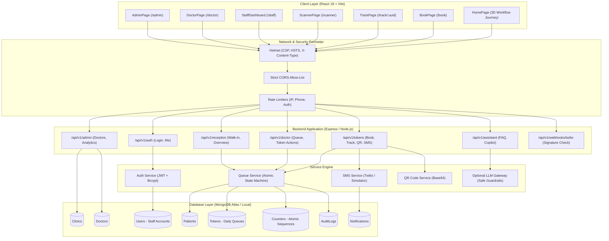

# Final Implementation Documentation — Smart Queue & Token System for Local Clinics

> **Academic Mini Project**  
> **Institution:** GL Bajaj Institute of Technology and Management, Greater Noida  
> **Department:** Computer Science & Engineering (Data Science)  
> **Evaluation Date:** October 2026  
> **Environment:** Node.js v24.21.0, npm v11.19.0, Vite 5.4.21, React 18, MongoDB v7/v8, Windows 11  
> **Verification Status:** 112/112 Server Tests Passed (24 suites) | 31/31 LLM Safety Tests Passed (3 suites) | 19/19 Client Tests Passed (3 suites) | Client Production Build Clean (7.25s)

---

## 1. Problem Statement

Small outpatient clinics in local Indian urban and suburban neighborhoods experience intense physical crowding during peak hours (8:30 AM – 1:30 PM). 

### Observed Deficiencies in Prevailing Operations:
1. **Physical Waiting Room Congestion:** Patients gather in high numbers in confined spaces, exacerbating infectious airborne transmission risks.
2. **Opaque Queue Visibility:** Patients are unaware of their exact turn or how long consultations take, leading to anxiety, reception desk harassment, and walk-away abandonments.
3. **Double-Booking & Queue Manipulation:** Manual paper token registers are susceptible to line-jumping, dispute, and unrecorded emergency walk-ins.
4. **Vulnerable Connectivity & Literacy Hurdles:** Many clinic patients lack smartphones, active data packs, or the literacy to navigate complex multi-step mobile apps.
5. **Carrier Cost & Telephony Vulnerability:** Premature reliance on commercial SMS gateways incurs recurring SMS costs and causes catastrophic queue failure when third-party telecom APIs experience latency, downtime, or regulatory DLT header rejections.

---

## 2. Project Objectives & Scope

### Primary Objectives:
* **Deterministic Server-Enforced Queue Lifecycle:** Implement atomic queue progression (`WAITING` $\rightarrow$ `CALLED` $\rightarrow$ `IN_CONSULTATION` $\rightarrow$ `COMPLETED`, plus `SKIPPED` and `CANCELLED`) with strict state-machine validation.
* **Zero-PII Public Live Tracking:** Allow patients to track their position and estimated wait time via an unguessable UUID tracking link (`/track/:trackingUuid`) without revealing patient names, phone numbers, staff emails, or internal medical notes.
* **Hybrid Access Modes:** Support online patient self-booking, reception-assisted walk-in issuance, and scannable physical QR tickets.
* **Resilient Offline-Tolerant Telephony:** Implement an SMS notification layer with automatic carrier fallback, DLT template compliance, idempotency keys, and zero-cost simulation mode (`SMS_ENABLED=false`).
* **Hardware-Accelerated 3D Landing Experience with Graceful Degradation:** Provide an intuitive 3D clinic workflow visualisation on the landing page, strictly isolated from patient booking/tracking routes, with zero-CPU background pausing and 2D canvas fallback.

### Scope Boundaries:
| Feature Area | Status | Implementation Details |
| :--- | :--- | :--- |
| **Queue Engine & State Machine** | **CONFIRMED IMPLEMENTED** | Atomic counters, daily reset, deterministic sorting, anti-manipulation audit trails. |
| **Live Tracking (`/track/:uuid`)** | **CONFIRMED IMPLEMENTED** | Strict `Cache-Control: no-store`, dynamic wait estimation, zero PII leakage. |
| **Multi-Role RBAC** | **CONFIRMED IMPLEMENTED** | Admin, Receptionist, and Doctor roles with service-level doctor ownership validation. |
| **SMS Notification Subsystem** | **CONFIRMED IMPLEMENTED** | Twilio integration with webhook signature verification, DLT templates, and stdout simulation. |
| **Landing Page 3D Experience** | **CONFIRMED IMPLEMENTED** | Three.js interactive journey, route isolation, 2D fallback, reduced-motion compliance. |
| **Inbound SMS Intent Parser (UC-1)** | **CONFIRMED PROTOTYPE** | Two-phase confirmation (PENDING $\rightarrow$ YES), deterministic fallback menu, prompt injection guards. |
| **Patient FAQ & Staff Copilot** | **OPTIONAL / FUTURE PHASE** | Grounded in approved clinic KB; allow-listed aggregate queries only; zero raw patient rows. |
| **Electronic Health Records (EHR)** | **EXCLUDED (OUT OF SCOPE)** | Prescriptions, lab diagnostics, billing, and pharmacy management are intentionally omitted to maintain queue focus. |

---

## 3. System Architecture & Tech Stack



### Technology Stack Justification:
* **Runtime & Language:** Node.js (ES Modules) — High-throughput event-driven asynchronous I/O ideal for polling and concurrent queue operations.
* **Server Framework:** Express 4.21 — Minimalist, un-opinionated middleware pipeline enabling precise rate-limiting, security headers, and RBAC guards.
* **Frontend Framework:** React 18 with Vite 5.4 — Sub-second HMR development, optimal tree-shaking, manual Rollup chunking to isolate 3D Three.js code from clinical tracking routes.
* **Database & ODM:** MongoDB 7/8 with Mongoose 8.9 — Document flexibility for evolving clinic/token schemas combined with atomic collection operators (`findOneAndUpdate` with `$inc`) for race-condition-free token issuance.
* **Security & Auth:** `bcryptjs` (salt rounds: 10), `jsonwebtoken` (signed HMAC-SHA256, 8-hour expiry), `helmet` (HTTP hardening), `express-rate-limit` (memory-based window limiters).

---

## 4. Repository Structure

```
d:/Smart Queue System for local clinics/
├── .env.example                     # Environment template for local, staging & prod
├── .gitignore                       # Ignores .env, node_modules, dist, logs
├── package.json                     # Monorepo workspaces definition
├── README.md                        # Quickstart, credentials, API reference
├── client/                          # React + Vite Frontend
│   ├── index.html                   # HTML entrypoint with metadata
│   ├── vite.config.js               # Manual chunks, Rollup code splitting
│   ├── src/
│   │   ├── main.jsx                 # Client bootstrapping
│   │   ├── App.jsx                  # React Router v6 route configuration
│   │   ├── index.css                # Custom CSS design system (zero Tailwind)
│   │   ├── api/client.js            # Axios/Fetch wrapper with JWT handling
│   │   ├── components/              # Shared UI components
│   │   │   ├── Navbar.jsx           # Responsive header navigation
│   │   │   ├── Button.jsx           # Accessible button with states
│   │   │   ├── TextField.jsx        # Accessible text inputs with error state
│   │   │   ├── PhoneInput.jsx       # 10-digit Indian mobile input with prefix
│   │   │   ├── StatusChip.jsx       # Token status pills
│   │   │   ├── TokenCard.jsx        # Live tracking ticket card
│   │   │   ├── EmptyState.jsx       # Zero-data UX placeholder
│   │   │   ├── ErrorState.jsx       # Resilient error boundary screen
│   │   │   └── Skeleton.jsx         # Loading shimmer placeholders
│   │   ├── context/
│   │   │   └── AuthContext.jsx      # React authentication state provider
│   │   ├── hooks/
│   │   │   └── useCanvasVisibility.js # Visibility API & IntersectionObserver hook
│   │   └── pages/
│   │       ├── HomePage.jsx         # Landing page with 3D canvas
│   │       ├── BookPage.jsx         # Online token booking form
│   │       ├── TrackPage.jsx        # Live zero-PII tracking screen + FAQ
│   │       ├── LoginPage.jsx        # Staff authentication portal
│   │       ├── StaffDashboard.jsx   # Reception & doctor combined dashboard
│   │       ├── DoctorPage.jsx       # Doctor consultation console
│   │       ├── AdminPage.jsx        # Clinic config & analytics
│   │       └── ScannerPage.jsx      # Camera QR code ticket scanner
│   └── tests/                       # Client accessibility & budget tests
│       ├── a11y_and_mobile.test.js
│       ├── motion_and_performance.test.js
│       └── workflow_journey.test.js
├── server/                          # Express Backend
│   ├── src/
│   │   ├── app.js                   # Express app configuration & middleware
│   │   ├── server.js                # Server entrypoint & HTTP listener
│   │   ├── config/                  # Environment, DB & constants
│   │   ├── models/                  # Mongoose models (User, Token, Doctor, etc.)
│   │   ├── routes/                  # REST route controllers
│   │   ├── controllers/             # Request handling logic
│   │   ├── services/                # Business logic (queue, auth, sms, qr, llm)
│   │   ├── middleware/              # Auth, RBAC, Rate-limit, Error handlers
│   │   ├── validators/              # Input validation rules
│   │   └── scripts/                 # Safe seed & development scripts
│   └── tests/                       # Server automated test suites
│       ├── auth.test.js
│       ├── queue.test.js
│       ├── health.test.js
│       ├── live_tracking.test.js
│       ├── twilio_webhook.test.js
│       └── llm/                     # LLM gateway & safety test suites
└── docs/                            # Academic & technical documentation
    ├── DECISIONS.md                 # Architecture decision records (ADRs)
    ├── DEPLOYMENT.md                # Deployment matrix & rollback SOP
    ├── SCHEMA.md                    # Database schema and index specifications
    ├── TEST_PLAN.md                 # Test plan & compliance matrix
    ├── VIVA_AND_OPTIONAL_PHASES.md  # Viva defense guide & LLM boundaries
    ├── FINAL_IMPLEMENTATION_REPORT.md # Comprehensive final project report
    ├── VIVA_PREPARATION_AND_MENTOR_QA.md # 18-topic concise viva answers
    ├── TEAM_TASK_BREAKDOWN.md       # 4-member student team workstream plan
    └── RELEASE_READINESS_AND_DEMO_SCRIPT.md # Demo checklist & contingency script
```

---

## 5. Database Schema & Index Specifications

### 1. `tokens` Collection
* **Fields:**
  * `clinicId`: `ObjectId` (Ref: Clinic)
  * `doctorId`: `ObjectId` (Ref: Doctor)
  * `patientId`: `ObjectId` (Ref: Patient)
  * `patientName`: `String` (Stored encrypted/unexposed in public responses)
  * `patientPhone`: `String` (Encrypted / masked in logs)
  * `normalizedPhone`: `String` (E.164 standard, e.g., `+919876543210`)
  * `date`: `String` (`YYYY-MM-DD` representation of appointment date)
  * `sequenceNumber`: `Number` (Daily sequential integer starting at 1)
  * `tokenNumber`: `String` (e.g. `T-001`, `T-002`)
  * `displayCode`: `String` (e.g. `DOC-GEN-101-001`)
  * `trackingUuid`: `String` (UUIDv4 unguessable tracking credential)
  * `activeBookingKey`: `String` (Compound key: `${doctorId}_${date}_${normalizedPhone}`)
  * `priority`: `String` (`EMERGENCY_WALKIN`, `ELDERLY`, `STANDARD`)
  * `priorityRank`: `Number` (`1` = Emergency, `2` = Elderly, `3` = Standard)
  * `status`: `String` (`WAITING`, `CALLED`, `IN_CONSULTATION`, `COMPLETED`, `SKIPPED`, `CANCELLED`)
  * `source`: `String` (`ONLINE`, `WALKIN`)
  * `bookedAt`: `Date`
  * `calledAt`: `Date`
  * `consultationStartedAt`: `Date`
  * `consultationCompletedAt`: `Date`
* **Critical Indexes:**
  * `{ trackingUuid: 1 }` (Unique, Sparse) — $O(1)$ live public status lookups.
  * `{ activeBookingKey: 1 }` (Unique, Partial Filter Expression: `{ status: { $in: ['WAITING', 'CALLED', 'IN_CONSULTATION'] } }`) — Prevents duplicate active bookings for the same patient, doctor, and date.
  * `{ doctorId: 1, date: 1, priorityRank: 1, bookedAt: 1 }` — High-efficiency compound index for sorted doctor queue retrieval.

### 2. `counters` Collection
* **Fields:**
  * `key`: `String` (e.g., `COUNTER_GLB-CLINIC-DEMO_DOC-GEN-101_2026-10-29`)
  * `seq`: `Number`
* **Atomicity Invariant:** Incremented exclusively using `findOneAndUpdate({ key }, { $inc: { seq: 1 } }, { upsert: true, new: true })`. Guarantees sequence continuity with zero gap or collision risk under concurrent patient booking requests.

---

## 6. Deterministic Queue Algorithm & Wait Estimation Formula

### Queue State Machine:
```
[WAITING] ──(call_next)──> [CALLED] ──(start_consultation)──> [IN_CONSULTATION] ──(complete)──> [COMPLETED]
   │                          │                                     │
(cancel)                   (skip / cancel)                      (skip)
   ▼                          ▼                                     ▼
[CANCELLED]               [SKIPPED]                             [SKIPPED]
                             │
                          (recall)
                             ▼
                         [WAITING]
```

### Dynamic Wait Estimation Formula:
The estimated wait time for token $i$ is calculated deterministically on the server:

$$\text{EstimatedWaitMinutes}_i = \sum_{k=1}^{N_i} \text{EstimatedDuration}_k$$

Where:
* $N_i$ is the count of patients ahead in the queue for the same doctor with higher or equal priority.
* $\text{EstimatedDuration}$ uses an adaptive rolling window:
  1. If completed consultations today $\ge 3$: $\text{EstimatedDuration} = \text{RollingMean}(\text{last } 20 \text{ consultations})$.
  2. If completed consultations today $< 3$: $\text{EstimatedDuration} = \text{doctor.avgConsultMinutes}$ (baseline benchmark).
  3. Clamped strictly between $2 \text{ minutes}$ and $60 \text{ minutes}$ to prevent outlier distortion.

### Honest Mathematical Limitations:
* **Emergency Preemption Disruption:** When an `EMERGENCY_WALKIN` patient arrives, they are inserted ahead of standard patients, which deterministically increments the wait estimate of all downstream patients by the expected emergency consult duration.
* **Complex Patient Variance:** Consultations with atypical clinical complexity may run longer than the rolling mean, causing real-world wait times to exceed initial estimates.

---

## 7. Security, Privacy & RBAC Implementation

### 1. Zero-PII Live Public Tracking
* **Credential:** The patient's `trackingUuid` acts as a bearer capability URL (`/track/983a3218-c013-4161-b7b9-86a05efee46a`).
* **Header Hardening:**
  * `Cache-Control: no-store, no-cache, must-revalidate, proxy-revalidate`
  * `Pragma: no-cache`
  * `Expires: 0`
* **Response Allow-List (Strict DTO):**
  ```json
  {
    "success": true,
    "data": {
      "tokenNumber": "T-001",
      "displayCode": "DOC-GEN-101-001",
      "status": "WAITING",
      "priority": "STANDARD",
      "patientsAhead": 0,
      "estimatedWaitMinutes": 0,
      "currentServingToken": "T-000",
      "doctor": {
        "name": "Dr. Priya Sharma",
        "department": "General Medicine",
        "roomNumber": "Room 101"
      },
      "clinic": {
        "name": "GL Bajaj Community Health Center",
        "address": "Plot No. 2, Knowledge Park III, Greater Noida"
      }
    }
  }
  ```
  *Zero patient names, zero phone numbers, zero staff emails, zero internal notes.*

### 2. Role-Based Access Control (RBAC) & Service-Level Doctor Scoping
* **Roles:** `ADMIN`, `DOCTOR`, `RECEPTIONIST`.
* **Doctor Isolation Invariant:** In [`doctor.service.js`](file:///d:/Smart%20Queue%20System%20for%20local%20clinics/server/src/services/doctor.service.js), access to `/api/v1/doctor/queue` enforces:
  ```javascript
  if (staffUser.role === ROLES.DOCTOR && String(staffUser.doctorId) !== String(targetDoctorId)) {
    throw new Error('Forbidden: Doctors may only view and mutate their own queue');
  }
  ```
  A doctor cannot inspect or advance another doctor's patients.

### 3. Rate Limiting Defense:
* `POST /api/v1/tokens/book`: Max 5 bookings per 15 minutes per IP; Max 3 bookings per day per phone number.
* `POST /api/v1/auth/login`: Max 10 attempts per 15 minutes per IP; 5 failed logins triggers a 15-minute account lockout on the user record.
* `POST /api/v1/assistant/*`: Max 15 queries per 15 minutes per IP.

---

## 8. Telephony & SMS Subsystem

* **Provider Integration:** Twilio REST API via official client SDK.
* **DLT Compliance:** Registered templates (`DLT-GLB-001-BOOK`, `DLT-GLB-002-NEARTURN`, `DLT-GLB-003-CALLED`, `DLT-GLB-004-COMPLETE`, `DLT-GLB-005-STATUS`).
* **Webhook Signature Verification:** `POST /api/v1/webhooks/twilio` validates `x-twilio-signature` using HMAC-SHA1 before updating message delivery status.
* **Simulation Mode:** When `SMS_ENABLED=false`, notifications are formatted, logged to stdout with masked phone numbers (`+91-******9001`), and saved in the database with status `SIMULATED`. The queue operates seamlessly with **zero carrier charges**.

---

## 9. Hardware-Accelerated 3D Design & Route Isolation

* **Canvas Technology:** Three.js with pure WebGL (zero Canvas 2D fallback when supported).
* **Route Isolation (Critical Performance Control):**
  * Three.js is bundled strictly into `three-bundle.js` (794 kB raw / 213 kB gzip).
  * Clinical routes (`/track/:uuid`, `/book`, `/doctor`, `/staff`, `/scanner`) **never load Three.js chunks**.
* **Zero-CPU Background Inactive Policy:**
  * [`useCanvasVisibility.js`](file:///d:/Smart%20Queue%20System%20for%20local%20clinics/client/src/hooks/useCanvasVisibility.js) uses `IntersectionObserver` and document `visibilitychange`.
  * Animation rendering loops halt immediately when the user scrolls past the canvas or switches browser tabs.
* **Accessibility Fallback:** Fully respects `prefers-reduced-motion: reduce` by replacing animated rotations with static isometric SVG cards.

---

## 10. Optional & Future Phase: LLM Gateway & Boundaries

* **Classification:** Explicitly treated as **Optional / Future Phase** (`[FUTURE / OPTIONAL PHASE]`).
* **Grounded Patient FAQ:** Bound strictly to `APPROVED_CLINIC_KB`. Medical advice or symptoms immediately trigger a hard handoff to clinic triage.
* **Staff Copilot:** Restricted to allow-listed read-only aggregate queries (`getSummary`, `getNoShowCounts`, `getAverageServiceTime`).
* **Verifiable Ground Truth:** Numerical source metrics are displayed side-by-side with generated narrative in the staff dashboard.
* **Zero Queue Mutation:** The LLM gateway has **no write APIs** and cannot book, call, or cancel tokens.

---

## 11. Automated Test Results Table

All tests executed on local environment (**Node v24.21.0**, **MongoDB 127.0.0.1:27017**, **Windows 11**):

| Test Suite / Workstream | Command | Suites | Tests | Result | Measured Duration |
| :--- | :--- | :---: | :---: | :---: | :---: |
| **Server Master Regression** | `npm.cmd test --workspace=server` | 24 | 112 | **112 / 112 PASS** | 21.66s |
| **LLM Gateway & Safety** | `node --test tests/llm/*.test.js` | 3 | 31 | **31 / 31 PASS** | 1.20s |
| **Client A11y & Motion Budget** | `npm.cmd test --workspace=client` | 3 | 19 | **19 / 19 PASS** | 238ms |
| **Client Production Build** | `npm.cmd run build --workspace=client` | N/A | 1637 modules | **CLEAN BUILD** | 7.25s |
| **Live Health Check** | `GET /api/v1/health` | 1 | 1 | **HTTP 200 OK** | 9ms |

---

## 12. Setup & Execution Instructions

```bash
# 1. Clone & Enter Project Root
cd "d:/Smart Queue System for local clinics"

# 2. Install Server & Client Dependencies
npm.cmd install --prefix server
npm.cmd install --prefix client

# 3. Provision Safe Demonstration Database (Idempotent Seed)
npm.cmd run seed --workspace=server

# 4. Execute Full Verification Suites
npm.cmd test --workspace=server
npm.cmd test --workspace=client
npm.cmd run build --workspace=client

# 5. Launch Development Services
# Terminal A:
npm.cmd run dev:server
# Terminal B:
npm.cmd run dev:client
```

---

## 13. System Limitations & Future Scope

### Honest Known Limitations:
1. **In-Memory Rate Limiting:** Rate limiters currently store hit counts in local Node.js process memory. In a multi-instance container cluster behind a load balancer, a Redis-backed store (`rate-limit-redis`) is required.
2. **Polling vs Push:** Live tracking relies on HTTP polling (default: 10s interval, throttled to 30s when inactive). WebSockets or Server-Sent Events (SSE) would reduce redundant HTTP headers during long waits.
3. **Doctor Adherence Dependency:** If a doctor forgets to click "Call Next" upon welcoming a patient, the live wait estimate lags behind reality.

### Future Scope (Post-Academic Roadmap):
1. **Physical Token Printer Integration:** ESC/POS thermal receipt printer integration at reception.
2. **Voice Announcement Bell:** Text-to-speech speaker broadcast (`"Token T-001, please proceed to Room 101"`) in waiting areas.
3. **Multi-Clinic Regional Network:** Tenant-isolated multi-clinic architecture allowing patient transfers between community health centers.
