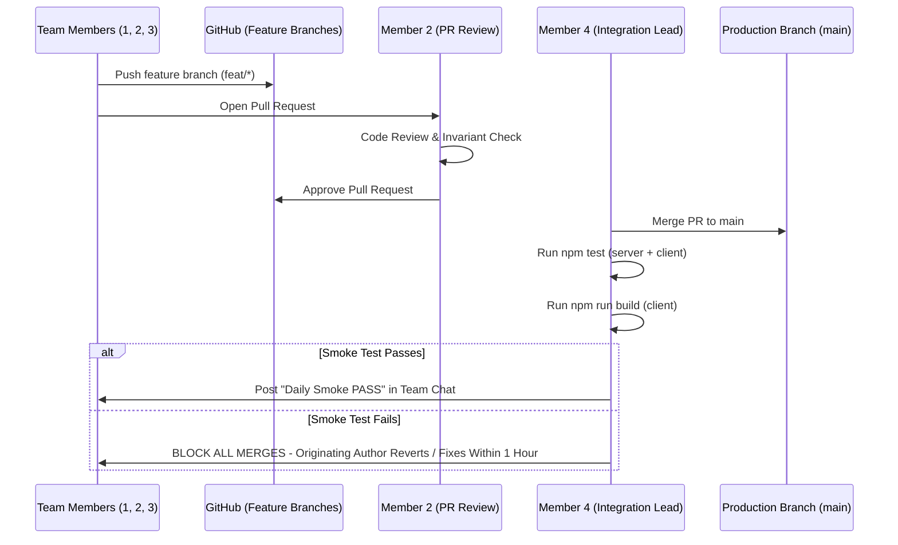

# Team Task Breakdown — Four-Person Engineering Roadmap

> **Academic Mini Project:** Smart Queue & Token System for Local Clinics  
> **Institution:** GL Bajaj Institute of Technology & Management, Greater Noida  
> **Department:** Computer Science & Engineering (Data Science)  
> **Team Size:** 4 Student Engineers  
> **Integration Owner:** Member 4 (Security, QA & Deployment Lead)  
> **Primary Code Reviewer (All PRs):** Member 2 (Backend & Queue Engine Lead)  

---

## 1. Governance, Coordination & Branching Strategy

### Rules of Engagement:
1. **Branch Naming Standard:** `feat/<member>-<feature-slug>` (e.g. `feat/m1-track-page`, `feat/m2-queue-service`).
2. **Commit Policy:** Small, single-purpose commits with semantic messages (`feat:`, `fix:`, `test:`, `docs:`). No multi-file monolithic commits.
3. **Daily Integration Smoke Test:** At 17:00 daily, all merged code on `main` must pass the smoke command:
   ```bash
   npm.cmd test --workspace=server && npm.cmd test --workspace=client && npm.cmd run build --workspace=client
   ```
4. **Pull Request Protocol:**
   * Every PR requires **at least one approving review from Member 2**.
   * PRs touching shared files (e.g., `server/src/app.js`, `client/src/App.jsx`, `package.json`) require coordination with the Integration Owner (Member 4) before opening.
5. **Phase Gating (Critical Rule):**
   * **Phase 1 (Core Queue & Auth):** Must achieve 100% test pass before Phase 2 begins.
   * **Phase 2 (Tracking, Telephony & Reception):** Must pass end-to-end verification before starting 3D visualisations.
   * **Phase 3 (3D Landing Experience & Optional Copilot):** Built strictly after core clinical workflows pass without errors.

---

## 2. Workstream Breakdown & Task Matrix

### Workstream 1: Frontend / UI & Patient Journey
**Lead Engineer:** **Member 1 (Frontend Specialist)**

| Task ID | Task Description | Prerequisites | Exact Deliverable | Key Files / Modules | Acceptance & Test Criteria | Target Milestone |
| :--- | :--- | :--- | :--- | :--- | :--- | :--- |
| **FE-01** | Core Design System & Tokens | Project Init | Custom responsive CSS tokens, layout grid, typography, color palettes (zero Tailwind). | `client/src/index.css` | Passes mobile 360px viewport test with zero horizontal overflow. | Day 2 |
| **FE-02** | Reusable UI Components | FE-01 | Accessible form inputs, buttons, status chips, skeleton loaders, and error boundaries. | `client/src/components/*` | Keyboard focus outlines visible; WCAG 2.1 AA contrast ratio compliant ($\ge 4.5:1$). | Day 4 |
| **FE-03** | Patient Booking Flow | FE-02, BE-02 | Multi-step booking form with doctor dropdown, phone formatting, and validation feedback. | `client/src/pages/BookPage.jsx` | Submits payload to `POST /tokens/book`; renders confirmation screen on success. | Day 6 |
| **FE-04** | Live Tracking Screen | FE-02, BE-03 | Zero-PII live queue position card with dynamic wait display and adaptive polling. | `client/src/pages/TrackPage.jsx` | Polls every 10s; throttles to 30s when tab is hidden; displays zero patient PII. | Day 8 |
| **FE-05** | QR Scanner Screen | FE-02, BE-04 | Browser camera barcode/QR scanner with manual token code fallback input. | `client/src/pages/ScannerPage.jsx` | Decodes UUID from camera feed; falls back cleanly to text input on camera error. | Day 10 |
| **FE-06** | 3D Landing Experience | FE-04, Phase 2 Pass | Three.js interactive 5-station clinic journey with 2D fallback and visibility hook. | `client/src/pages/HomePage.jsx`, `client/src/hooks/useCanvasVisibility.js` | Bundle isolated into `three-bundle.js`; WebGL pauses off-screen; passes reduced-motion test. | Day 13 |

---

### Workstream 2: Backend / API & Queue State Machine
**Lead Engineer:** **Member 2 (Backend & Architecture Lead - PR Reviewer)**

| Task ID | Task Description | Prerequisites | Exact Deliverable | Key Files / Modules | Acceptance & Test Criteria | Target Milestone |
| :--- | :--- | :--- | :--- | :--- | :--- | :--- |
| **BE-01** | Express Server & Route Architecture | Project Init | Versioned Express application pipeline with Helmet, CORS, and centralized error middleware. | `server/src/app.js`, `server/src/server.js`, `server/src/routes/*` | `GET /api/v1/health` returns status: 200 with uptime and service metadata. | Day 2 |
| **BE-02** | Atomic Counter & Sequence Generator | DB-01 | Daily atomic sequence number incrementer without race conditions or gaps. | `server/src/services/queue.service.js`, `server/src/models/Counter.js` | 10 concurrent booking requests generate sequential tokens (`T-001` to `T-010`) with zero duplicates. | Day 4 |
| **BE-03** | Queue State Machine & Actions | BE-02, DB-02 | Enforced token state transitions (`WAITING` $\rightarrow$ `CALLED` $\rightarrow$ `IN_CONSULTATION` $\rightarrow$ `COMPLETED`). | `server/src/services/queue.service.js`, `server/src/controllers/doctor.controller.js` | Disallowed transitions (e.g. `COMPLETED` $\rightarrow$ `WAITING`) throw HTTP 400 Bad Request. | Day 6 |
| **BE-04** | Rolling Wait Time Estimator | BE-03 | Server-side dynamic wait calculation based on doctor's rolling average consultation duration. | `server/src/services/queue.service.js` | Clamps estimates between 2 and 60 minutes; accurately recalculates upon patient completion. | Day 8 |
| **BE-05** | Doctor Queue & Ownership Guard | BE-03, SEC-02 | Doctor-specific queue retrieval and state advancement with service-level IDOR validation. | `server/src/services/doctor.service.js`, `server/src/routes/doctor.routes.js` | Doctor A attempting to access Doctor B's queue receives HTTP 403 Forbidden. | Day 10 |
| **BE-06** | Optional LLM Gateway Prototype | BE-05, Phase 2 Pass | Bounded NLP parsing for SMS bookings with prompt-injection defense and menu fallback. | `server/src/services/llm/*` | All 31 safety test cases pass; LLM never mutates queue state directly. | Day 13 |

---

### Workstream 3: Database, Seed Data, Indexes & Analytics
**Lead Engineer:** **Member 3 (Database & Data Systems Lead)**

| Task ID | Task Description | Prerequisites | Exact Deliverable | Key Files / Modules | Acceptance & Test Criteria | Target Milestone |
| :--- | :--- | :--- | :--- | :--- | :--- | :--- |
| **DB-01** | Mongoose Schemas & Connections | Project Init | Schema definitions for Clinic, Doctor, Patient, User, Token, Counter, and AuditLog. | `server/src/models/*`, `server/src/config/db.js` | Mongoose connects cleanly with health check ping; strict schema validation enforced. | Day 2 |
| **DB-02** | High-Performance Compound Indexes | DB-01 | Optimal index configurations for fast lookups, sorting, and duplicate prevention. | `server/src/models/Token.js`, `server/src/models/Counter.js` | Unique compound index on `activeBookingKey`; sparse unique index on `trackingUuid`. | Day 4 |
| **DB-03** | Safe Academic Seed Engine | DB-02 | Idempotent seed script creating demo clinic, 3 doctors, 5 staff accounts, and active tokens. | `server/src/scripts/seed.js`, `server/src/scripts/seedSafe.js` | `npm run seed` executes without error; safely preserves production data unless forced. | Day 6 |
| **DB-04** | Reception Walk-in Priority Handling | DB-02, BE-03 | Priority tagging mechanism for Walk-in, Elderly, and Emergency patients. | `server/src/controllers/reception.controller.js` | Emergency walk-ins automatically rank at priority 1, ordering ahead of standard online bookings. | Day 8 |
| **DB-05** | Clinic Throughput Analytics Engine | DB-02, BE-03 | Aggregation pipelines for daily token counts, average wait time, and doctor utilization. | `server/src/controllers/admin.controller.js` | `GET /api/v1/admin/analytics` returns accurate aggregated metrics without exposing raw PII. | Day 10 |
| **DB-06** | Database Migration & Rollback SOP | DB-03 | Database backup, restore, and safe rollback verification procedures. | `docs/SCHEMA.md`, `docs/DEPLOYMENT.md` | Documented mongodump/mongorestore commands validated on staging instance. | Day 12 |

---

### Workstream 4: Security, Authentication, Integrations, QA & Deployment
**Lead Engineer:** **Member 4 (Security, QA & Deployment Lead - Integration Owner)**

| Task ID | Task Description | Prerequisites | Exact Deliverable | Key Files / Modules | Acceptance & Test Criteria | Target Milestone |
| :--- | :--- | :--- | :--- | :--- | :--- | :--- |
| **SEC-01** | Password Hashing & JWT Auth | DB-01 | Bcrypt authentication with salt rounds 10 and signed 8-hour JWT issuance. | `server/src/services/auth.service.js`, `server/src/middleware/auth.middleware.js` | Passwords hashed; invalid credentials return generic HTTP 401; 5 failures locks account. | Day 3 |
| **SEC-02** | Role-Based Access Control (RBAC) | SEC-01 | Express middleware guarding routes based on staff roles (`ADMIN`, `DOCTOR`, `RECEPTIONIST`). | `server/src/middleware/auth.middleware.js` | Unauthorized roles receive HTTP 403 Forbidden with uniform error JSON. | Day 5 |
| **SEC-03** | Privacy Review & Zero-PII Audit | FE-04, BE-03 | Response scrubbing ensuring public endpoints return zero patient names, phones, or notes. | `server/src/controllers/token.controller.js` | Automated privacy test confirms zero PII exposed in `/tokens/track/:uuid` payload. | Day 7 |
| **SEC-04** | Twilio Telephony & SMS Simulation | BE-03 | Dual-mode SMS dispatcher with DLT templates, signature validation, and stdout simulation. | `server/src/services/sms.service.js`, `server/src/routes/webhook.routes.js` | `SMS_ENABLED=false` logs simulation safely; invalid webhook signatures return HTTP 403. | Day 9 |
| **SEC-05** | Master Test Automation Suite | All Streams | Unified test runner for unit, integration, concurrency, and accessibility verification. | `server/tests/*`, `client/tests/*` | 112 server tests + 31 LLM tests + 19 client tests pass 100% on automated run. | Day 12 |
| **SEC-06** | Production Build & Deployment Pipeline | SEC-05 | Production environment templates, build optimization, and deployment runbook. | `server/.env.example`, `client/vite.config.js`, `docs/DEPLOYMENT.md` | Client production build compiles in $< 15\text{s}$; zero secrets leaked in frontend bundle. | Day 14 |

---

## 3. Daily Integration Smoke Test Schedule

To prevent "integration hell" at project submission, the following daily sequence is executed every evening by **Member 4**:



---

## 4. Communication & Anti-Collision Protocols

1. **Locking Files Before Major Refactors:** If a member needs to modify shared infrastructure (`server/src/app.js` or `client/src/App.jsx`), they must declare an active lock in the team chat. No other member may commit to that file until the lock is released.
2. **Pre-Commit Verification:** Every developer must execute:
   ```bash
   npm.cmd test --workspace=server
   ```
   locally before pushing any commit. Pushing broken tests to remote branches is strictly prohibited.
3. **Weekly Mentor Review Gate:** Every Friday at 15:00, the working deployment is demonstrated live to academic project guides using the verified seed dataset.
